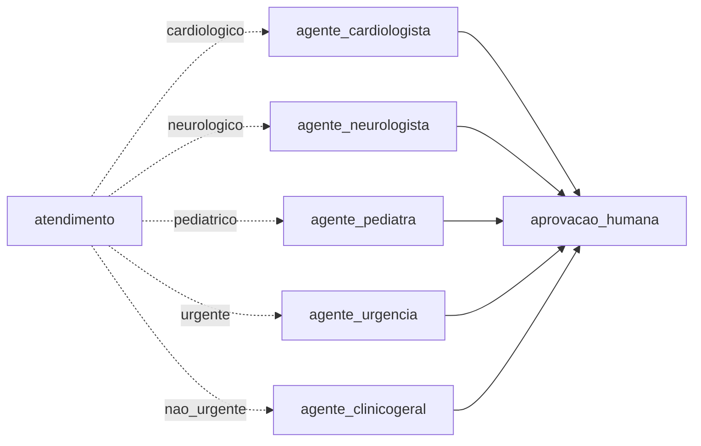

# Como criar um novo agente especialista

Este guia mostra, passo a passo, como acrescentar um especialista ao grafo. O exemplo é um **`agente_pediatra`**, que atende crianças e adolescentes. Para outra especialidade, troque os nomes e o prompt; os passos são os mesmos.

Ao final, o fluxo fica assim:



## O que precisa mudar

| # | Arquivo | O que fazer |
|---|---|---|
| 1 | [src/state.py](../src/state.py) | Criar o modelo do parecer, acrescentar o campo no `State` e a nova especialidade |
| 2 | `src/nodes/agente_pediatra.py` (novo) | Criar o nó: prompt, resposta estruturada e `create_agent` |
| 3 | [src/nodes/atendimento.py](../src/nodes/atendimento.py) | Ensinar a triagem a reconhecer a especialidade |
| 4 | [src/edges/roteamento.py](../src/edges/roteamento.py) | Criar o ramo no roteamento |
| 5 | [src/graph.py](../src/graph.py) | Registrar o nó e as arestas |
| 6 | [src/nodes/aprovacao_humana.py](../src/nodes/aprovacao_humana.py) | Mostrar o novo parecer ao revisor |
| 7 | [exemplo.py](../exemplo.py) | Registrar o tipo do parecer e mostrá-lo no terminal |
| 8 | Terminal e Studio | Testar |

O padrão é o mesmo do `agente_neurologista` (commit `3b1fc97`). Para ver tudo o que aquele commit mudou:

```bash
git show 3b1fc97 --stat
```

> Faça os passos na ordem. O grafo só volta a carregar quando os passos 1 a 5 estiverem feitos.

---

## Passo 1: o state ([src/state.py](../src/state.py))

O state é o "formulário" que passa por todos os nós. O novo agente precisa de um lugar para gravar o parecer dele.

### 1a. Modelo do parecer

Acrescente, junto dos outros pareceres:

```python
class ParecerPediatrico(BaseModel):
    """Parecer emitido pelo agente pediatra."""

    hipotese_diagnostica: str = Field(description="Hipotese diagnostica pediatrica principal")
    risco: Literal["alto", "moderado", "baixo"] = Field(description="Nivel de risco imediato para a crianca")
    condutas: list[str] = Field(description="Condutas e exames iniciais sugeridos, ex.: hidratacao oral, hemograma")
    orientacoes_responsaveis: list[str] = Field(description="Orientacoes aos pais ou responsaveis, incluindo sinais de alarme")
```

Os campos são o que você quer que o especialista devolva. O modelo lê cada `description` para saber o que preencher, então descreva bem.

### 1b. Nova especialidade

No `State`, acrescente `"pediatria"` ao `Literal` de `especialidade`:

```python
especialidade: Literal["cardiologia", "neurologia", "pediatria", "geral"] | None = Field(None, description="Especialidade indicada pela triagem")
```

### 1c. Campo do parecer no `State`

Junto dos outros pareceres:

```python
# Preenchido pelo agente_pediatra: so quando a triagem indica pediatria.
parecer_pediatrico: ParecerPediatrico | None = Field(None, description="Parecer do pediatra")
```

O campo começa como `None` e só é preenchido se o caso passar pelo pediatra.

## Passo 2: o nó do agente (`src/nodes/agente_pediatra.py`)

Crie o arquivo. A melhor forma é copiar o [agente_neurologista.py](../src/nodes/agente_neurologista.py) e trocar o que é de neurologia:

```python
"""No agente_pediatra: parecer pediatrico com apoio do RAG sobre o CID-10."""

from langchain.agents import create_agent
from pydantic import BaseModel, Field

from src.services.llm import modelo
from src.state import CidSugerido, ParecerPediatrico, State
from src.tools.cid10 import buscar_cid10

PROMPT_PEDIATRA = """Voce e um medico pediatra avaliando o prontuario de uma crianca
ou adolescente encaminhado pela triagem.

1. Separe todos os sintomas e sinais clinicos descritos no prontuario.
2. Para cada um, chame a ferramenta buscar_cid10 (um sintoma por chamada), usando
   o termo medico (ex.: "febre" em vez de "corpo quente", "vomitos" em vez de "golfando").
3. Para cada sintoma, escolha a categoria do CID-10 mais adequada entre as que a
   ferramenta devolveu.
4. Emita um parecer pediatrico: hipotese diagnostica principal, nivel de risco imediato
   (alto, moderado ou baixo), condutas e exames iniciais e orientacoes aos responsaveis,
   incluindo os sinais de alarme para voltar ao servico.
   Considere a idade, o peso (se informado), a hidratacao e a classificacao de urgencia
   da triagem ao definir o risco.

Use somente codigos devolvidos pela ferramenta: nunca invente um codigo. Se nenhuma
categoria devolvida servir para um sintoma, nao sugira CID para ele."""


class ResultadoPediatra(BaseModel):
    """Resultado do agente pediatra."""

    sintomas: list[str] = Field(description="Sintomas e sinais clinicos separados do prontuario")
    cids_sugeridos: list[CidSugerido] = Field(description="Categoria do CID-10 sugerida para cada sintoma")
    # Sem Field(description=...): em streaming a API exige schema estrito, e la um campo
    # que aponta para outro modelo ($ref) nao pode ter descricao propria.
    parecer: ParecerPediatrico


def agente_pediatra(state: State) -> dict:
    """Roda o agente com a ferramenta de RAG e devolve so os campos que altera no state."""
    agente = create_agent(
        modelo(),
        [buscar_cid10],
        system_prompt=PROMPT_PEDIATRA,
        response_format=ResultadoPediatra,
    )
    entrada = (
        f"Triagem: {state.urgencia} - {state.justificativa}\n\n"
        f"Prontuario:\n{state.prontuario}"
    )
    saida = agente.invoke({"messages": [("human", entrada)]})
    resultado: ResultadoPediatra = saida["structured_response"]
    return {
        "sintomas": resultado.sintomas,
        "cids_sugeridos": resultado.cids_sugeridos,
        "parecer_pediatrico": resultado.parecer,
    }
```

O que cada parte faz:

- **`PROMPT_PEDIATRA`**: a "personalidade" e o método do agente. É o que mais muda de um especialista para outro.
- **`buscar_cid10`**: a ferramenta de RAG sobre o CID-10 ([docs/RAG.md](RAG.md)). O agente decide sozinho quando chamá-la.
- **`ResultadoPediatra`**: o formato da resposta final. O `create_agent` com `response_format` obriga o modelo a devolver exatamente esses campos, já validados pelo Pydantic.
- **`return {...}`**: o nó devolve **só os campos que altera**. O LangGraph junta esse dicionário ao state. Os nomes das chaves precisam ser iguais aos campos do `State` (`parecer_pediatrico`).

## Passo 3: a triagem ([src/nodes/atendimento.py](../src/nodes/atendimento.py))

A triagem precisa saber que a especialidade existe e quando escolhê-la.

### 3a. No `PROMPT_TRIAGEM`

Acrescente a especialidade na lista, antes de `"geral"`:

```
- "pediatria": paciente com menos de 18 anos, qualquer que seja a queixa.
```

E deixe claro o que vem primeiro quando dois critérios valem ao mesmo tempo, por exemplo:

```
Se o paciente tiver menos de 18 anos, indique "pediatria" mesmo que a queixa seja
cardiologica ou neurologica.
```

### 3b. No modelo `Classificacao`

```python
especialidade: Literal["cardiologia", "neurologia", "pediatria", "geral"] = Field(description="Especialidade indicada")
```

Se você esquecer este passo, o modelo não consegue responder `"pediatria"`: o `Literal` só aceita os valores listados.

## Passo 4: o roteamento ([src/edges/roteamento.py](../src/edges/roteamento.py))

A função `rotear_triagem` lê o state e devolve o nome do ramo. Ela não chama o modelo.

```python
def rotear_triagem(
    state: State,
) -> Literal["cardiologico", "neurologico", "pediatrico", "urgente", "nao_urgente"]:
    if state.especialidade == "cardiologia":
        return "cardiologico"
    if state.especialidade == "neurologia":
        return "neurologico"
    if state.especialidade == "pediatria":
        return "pediatrico"
    return "nao_urgente" if state.urgencia == "nao_urgente" else "urgente"
```

Acrescente o novo ramo **também no `Literal` do retorno**: é por ele que o LangGraph Studio desenha as setas.

## Passo 5: o grafo ([src/graph.py](../src/graph.py))

Três mudanças:

```python
from src.nodes.agente_pediatra import agente_pediatra

builder.add_node("agente_pediatra", agente_pediatra)
```

No mapa da aresta condicional do `atendimento`, ligue o ramo ao nó:

```python
builder.add_conditional_edges(
    "atendimento",
    rotear_triagem,
    {
        "cardiologico": "agente_cardiologista",
        "neurologico": "agente_neurologista",
        "pediatrico": "agente_pediatra",
        "urgente": "agente_urgencia",
        "nao_urgente": "agente_clinicogeral",
    },
)
```

E faça o novo agente passar pela aprovação humana:

```python
builder.add_edge("agente_pediatra", "aprovacao_humana")
```

Atualize também a docstring do arquivo, que desenha o fluxo.

> A chave do mapa (`"pediatrico"`) é o que `rotear_triagem` devolve; o valor (`"agente_pediatra"`) é o nome dado em `add_node`. Se não baterem, o grafo dá erro ao compilar ou ao rodar.

Confira que o grafo carrega:

```bash
.venv/bin/python -c "from src.graph import grafo; print(list(grafo.nodes))"
```

No Windows: `.venv\Scripts\python -c "..."`. A lista deve incluir `agente_pediatra`.

## Passo 6: a aprovação humana ([src/nodes/aprovacao_humana.py](../src/nodes/aprovacao_humana.py))

O revisor precisa ver o novo parecer. Na função `_pacote_revisao`, acrescente o campo à tupla:

```python
for campo in ("parecer_cardiologico", "parecer_neurologico", "parecer_pediatrico", "parecer_clinico"):
```

Sem isso, o fluxo funciona, mas o revisor aprova sem ver o parecer do pediatra.

## Passo 7: o script de exemplo ([exemplo.py](../exemplo.py))

Duas mudanças:

1. Em `TIPOS_DO_STATE`, acrescente `"ParecerPediatrico"`. É a lista de tipos que o checkpointer pode reconstruir quando o fluxo retoma depois da pausa. Sem ela aparece o aviso `Deserializing unregistered type src.state.ParecerPediatrico`.
2. Em `mostrar_parecer`, acrescente `"parecer_pediatrico"` à tupla de campos, como no passo 6.

## Passo 8: testar

### No terminal

```bash
.venv/bin/python exemplo.py "Menino, 4 anos, 16 kg. Febre de 39 graus ha 2 dias, tosse e coriza. Aceitando liquidos, ativo entre os picos de febre. FR 28 irpm, SpO2 97%."
```

No Windows, troque `.venv/bin/python` por `.venv\Scripts\python`.

Esperado:

- `Especialidade: pediatria`;
- um bloco `parecer_pediatrico:` com hipótese, risco, condutas e orientações;
- a pergunta `Aprovar o parecer? (s/n)`.

Teste também um adulto (por exemplo, o prontuário padrão do `exemplo.py`, sem argumento) para garantir que os outros ramos continuam iguais.

### No LangGraph Studio

```bash
.venv/bin/langgraph dev
```

O grafo deve mostrar o nó `agente_pediatra` ligado ao `atendimento` e ao `aprovacao_humana`. Rode com um prontuário pediátrico e confira que a execução passa por ele e pausa na aprovação.

## Passo 9: documentar

No [README.md](../README.md):

- o diagrama mermaid e a lista de ramos em "Como funciona";
- a descrição do nó em "Etapa atual";
- a tabela do State (`especialidade` e a linha `parecer_pediatrico`);
- a árvore de arquivos em "Estrutura".

---

## Problemas comuns

| Sintoma | Causa provável | Solução |
|---|---|---|
| `ImportError: cannot import name 'ParecerPediatrico'` | O modelo não foi criado no `state.py`, ou o nome está diferente | Passo 1a |
| `ValueError: ... 'pediatrico' ... not found` (ou erro de branch) ao rodar | O ramo devolvido por `rotear_triagem` não está no mapa de `add_conditional_edges` | Passo 5: a chave do mapa tem que ser igual ao retorno |
| A triagem nunca escolhe `pediatria` | Faltou o valor no `Literal` de `Classificacao`, ou o prompt não explica quando escolher | Passo 3 |
| `ValidationError` em `especialidade` | O `Literal` do `State` não tem `"pediatria"` | Passo 1b |
| O parecer não aparece no state final | A chave devolvida pelo nó não é igual ao campo do `State` | Passo 2: `"parecer_pediatrico"` dos dois lados |
| O revisor não vê o parecer | Faltou o campo em `_pacote_revisao` | Passo 6 |
| Aviso `Deserializing unregistered type ...ParecerPediatrico` | Faltou o tipo em `TIPOS_DO_STATE` | Passo 7 (no `langgraph dev` o aviso continua e pode ser ignorado) |
| O Studio não desenha a seta do novo ramo | Faltou o ramo no `Literal` do retorno de `rotear_triagem` | Passo 4 |

## Checklist

- [ ] `ParecerPediatrico` em `state.py`
- [ ] `"pediatria"` no `Literal` de `especialidade` (State)
- [ ] `parecer_pediatrico` no `State`
- [ ] `src/nodes/agente_pediatra.py` com prompt, `ResultadoPediatra` e `create_agent`
- [ ] `"pediatria"` no prompt e no `Literal` de `Classificacao` (atendimento)
- [ ] ramo `"pediatrico"` em `rotear_triagem` e no `Literal` do retorno
- [ ] `add_node`, mapa da aresta condicional e `add_edge` para `aprovacao_humana` em `graph.py`
- [ ] `parecer_pediatrico` em `_pacote_revisao`
- [ ] `ParecerPediatrico` em `TIPOS_DO_STATE` e `parecer_pediatrico` em `mostrar_parecer` (exemplo.py)
- [ ] testado com um prontuário pediátrico e um adulto
- [ ] README atualizado
